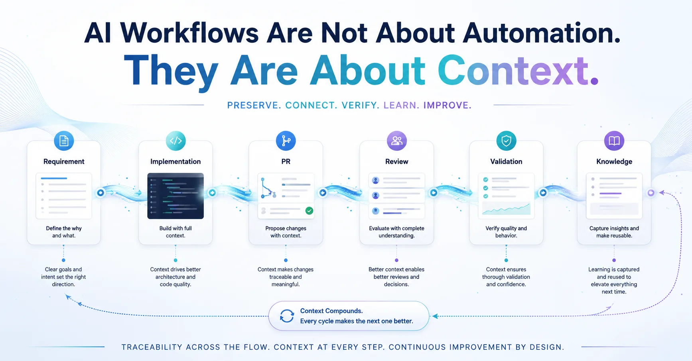

# AI Workflows Are Not About Automation. They Are About Context.

When I first started bringing AI into my software workflow, I thought mostly about automation.

Can AI help me write Jira tickets?  
Can it draft PR descriptions?  
Can it summarize issues?  
Can it review code?

The answer is yes.

And those things are useful.

But after using AI more seriously in real projects, I’ve started to care less about whether AI can help me do one step faster.

I care more about whether each piece of work leaves behind better context for the next one.

Because in real work, context gets lost all the time.

A Jira ticket explains the requirement, but the PR may not show why the solution was designed that way.

A review comment catches an issue, but the lesson may never make it back into the ticket or the team’s memory.

A test passes or fails, but the reason often stays in a log, a comment, or someone’s head.

Then a few weeks later, the team runs into a similar problem and has to rediscover the same context again.

This is where AI becomes more interesting to me.

Not just as a tool that produces more text or more code.

But as a tool that helps connect the signals across the workflow.

It can read the original requirement.  
Compare the implementation against the goal.  
Summarize review risks.  
Capture validation results.  
Turn repeated lessons into reusable knowledge.

That changes how I think about AI workflow.

The goal is not just to make AI produce more artifacts.

The goal is to make the workflow more traceable, more verifiable, and more capable of learning from itself.

A requirement should not disappear after planning.

A PR should not just be a place where code gets merged.

A test result should not be a one-time pass or fail.

A retrospective should not just be a meeting that feels useful for one hour and then disappears.

Every delivery should leave better context for the next delivery.

That is why I think good AI workflows are not mainly about prompt templates.

Templates can help with consistency.

But the real value is in the system behind them:

How intent is captured.  
How decisions are recorded.  
How validation results are preserved.  
How lessons flow back into the next round of work.

In short:

AI workflow is not about producing more output.

It is about turning every delivery into better context for the next one.

P.S. Pair-written with Codex. Using an AI workflow to write about AI workflows.

## Infographic

## Adapted From

- [Traditional Chinese original](zh-TW.md)

Originally posted on [LinkedIn](https://www.linkedin.com/feed/update/urn:li:share:7461018872431788032/).
