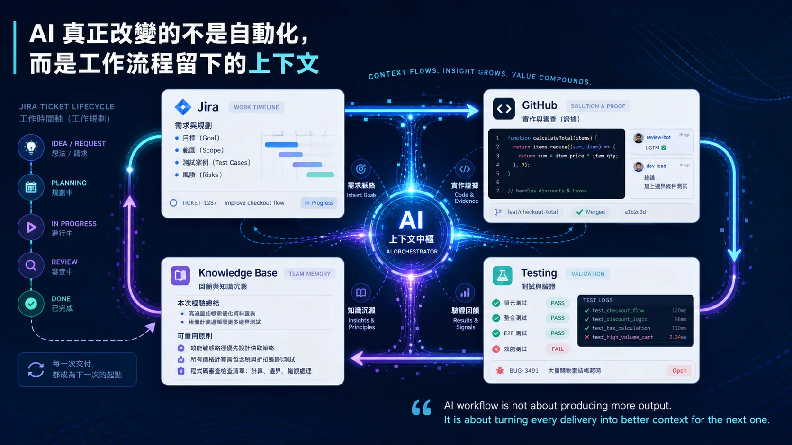

# AI 真正改變的不是自動化，而是工作流程留下的上下文

我最近開始想把一些軟體工作流程和管理方法整理成系列筆記。

不是工具教學，也不是管理口號，而是紀錄一些在實際專案裡反覆遇到的問題：

需求怎麼定義？
決策怎麼留下？
review 怎麼回到原本的目標？
測試結果怎麼變成下一次工作的上下文？
知識怎麼從一次任務，變成團隊可以重複使用的經驗？

AI 出現後，這些問題沒有消失。

只是很多以前太瑣碎、太容易被省略的整理工作，現在開始有機會被放回流程裡。

我以前把 AI 放進工作流程時，第一個想到的也是自動化。

例如讓 AI 幫忙寫 Jira ticket、產 PR description、整理 issue、做 code review。

這些都很有用，但如果只停在這裡，很容易變成「單點效率提升」。

某個步驟變快了，但整個流程的上下文還是斷的。

Jira 裡有需求，但 GitHub 裡的實作不一定看得出當初為什麼這樣設計。
PR 裡有 review comment，但不一定會回到原本的 ticket 或規格。
測試過了或沒過，常常只存在某個 comment、log，或人的記憶裡。
做完一輪之後，下次遇到類似問題，團隊還是可能重新踩一次。

所以我現在更在意的是：

每一次工作，有沒有留下下一次可以使用的上下文？

以 Jira 和 GitHub 來說，我不會把它們看成單純的工具分工，而是看成一個工作流程裡不同類型的紀錄。

Jira 不一定要承載所有細節，但它很適合作為一張票的工作時間線。

Planning 階段，目標、範圍、測試案例和風險會先寫在 Jira issue description。

我會刻意先寫測試案例，因為 planning 不只是描述要做什麼，也是在定義完成後該如何驗證。

至於實作和 review 的細節，則留在 GitHub PR。

只要 branch 或 PR 名稱帶著 Jira issue key，Jira 就會自動關聯相關 PR。

因此 Jira comment 不需要重複 PR 裡的內容，而是補上階段性摘要：目前做到哪裡、驗證結果如何、是否有風險或後續處理。

測試沒過時，記錄 bug、原因和下一步。
測試通過時，記錄驗證結果。
收尾時，留下決策和後續要沉澱的經驗。

這樣 Jira 就不是一份大文件，而是一張票完整生命週期的時間線。

GitHub 也不是只有放 code。

它承載的是實作、review 和驗證的紀錄。

如果 Jira 是工作時間線，GitHub 就是解法和證據。

AI 放在中間，最有價值的地方不是取代人做決策，而是幫忙把這些分散在不同工具裡的訊號整理起來。

從 Jira issue 讀出需求和驗收標準。
從 GitHub PR 對照實作是否符合原本目標。
從 review 和測試結果整理風險。
從完成後的 retrospective 抽出下次要遵守的原則。
最後再把值得保留的經驗沉澱到知識庫。

這樣一來，每一次工作就不只是「完成一張票」。

它會變成下一次工作的上下文。

我現在越來越覺得，好的 AI 工作流程，不是追求全自動，也不是追求讓 AI 產出越多越好。

更重要的是讓流程變得可追蹤、可驗證、可回饋。

需求不是寫完就消失。
實作不是 merge 就結束。
review 不是看過就算了。
測試不是 pass 就沒有後續。

每一輪工作，都應該留下可以被下一輪使用的 context。

這也是我目前對 AI workflow 最大的體驗：

AI 真正改變的，不只是工作速度，而是團隊的經驗及知識累積。

當 Jira、GitHub、測試和知識庫能串成一個回饋循環，AI 才不只是另一個工具，而是開始成為工作系統的一部分。

In short:
AI workflow is not about producing more output.
It is about turning every delivery into better context for the next one.

P.S. Pair-writing with Codex. 用 AI workflow 寫 AI workflow.
