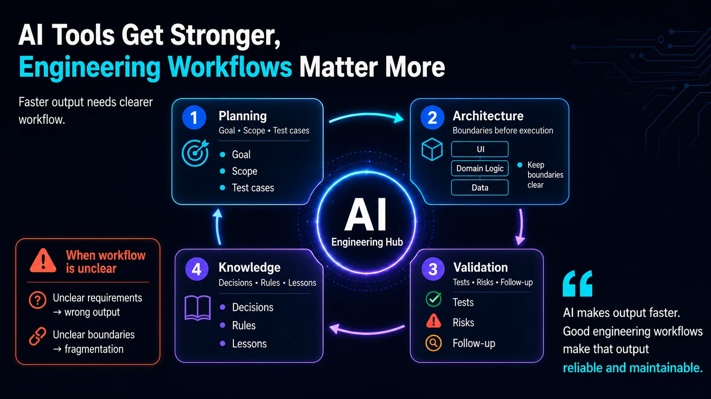

# The Stronger AI Tools Become, the More Engineering Workflow Matters

AI makes output faster.

But it also makes every unclear part of the process fail faster.

If the requirement is unclear, AI can produce the wrong thing faster.

If the scope is not well defined, AI can spread the change faster.

If test cases are missing, AI can produce something that looks complete but is hard to verify.

If architectural boundaries are unclear, AI can copy the wrong pattern faster.

That is why I no longer think of AI workflow as "how do I make AI do more steps?"

I care more about these questions:

Can AI understand this work environment?  
Can this task be clearly verified?  
Can this process preserve lessons when something goes wrong?  
Can the next piece of work require less guessing?

Another important point:

Do not let the system become fragmented every time AI executes a task.

AI is good at using local context to solve the problem in front of it. But if architectural boundaries are not explicit, each run may patch a hole with a different local solution.

Once or twice, that feels fast.

Over time, module boundaries drift, folder structures become inconsistent, business logic moves into the wrong layer, and cross-platform implementations evolve in different directions.

So planning is not only about defining what should be built.

It also has to define how to build it without damaging the architecture.

For example:

What is the goal?  
Where is the scope boundary?  
What are the test cases?  
Which logic belongs in which layer?  
Which existing patterns should be preserved?  
How will the result be verified?

This is why templates, including prompt templates, are not the core of AI workflow.

They can make output formatting more consistent.

But they cannot guarantee a clear problem, reasonable scope, sufficient tests, clean boundaries, or review aligned with the goal.

What matters is the workflow behind the templates.

For example:

A Jira issue should clarify goal, scope, test cases, and risks.

A GitHub PR should preserve implementation, review, and validation evidence.

Test results should flow back into the ticket or retrospective.

A knowledge base should turn recurring lessons into long-term memory.

When AI is placed inside this kind of workflow, it does not merely accelerate output.

It starts to amplify the whole engineering system.

The stronger AI tools become, the more engineering workflow matters.

Things that used to live in people's heads, or be filled in through team intuition, now need to be organized into a form that AI can read, execute, and verify.

In short:

AI makes output faster.  
Good engineering workflows make that output reliable and maintainable.

P.S. Pair-written with Codex. Continuing to use an AI workflow to write about AI workflows.

## Infographic

## References

- OpenAI, [Harness engineering: leveraging Codex in an agent-first world](https://openai.com/index/harness-engineering/) (2026-02-11)

## Adapted From

- [Traditional Chinese original](zh-TW.md)

Originally posted on [LinkedIn](https://www.linkedin.com/feed/update/urn:li:share:7463797968609980416/).
