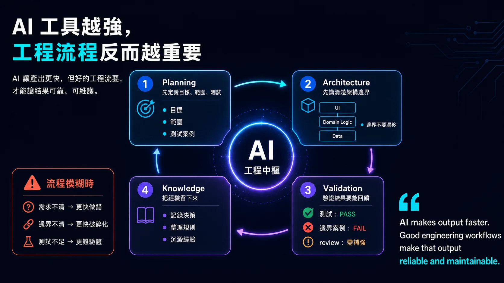

# AI 工具越強，工程流程反而越重要

前一篇我寫到，AI 真正改變的不是自動化，而是工作流程能不能留下上下文。

這幾天我又看到 OpenAI 一篇關於 Harness Engineering 的文章，裡面有一個方向我很有感：

當 agent 可以大量產出 code，人類工程師的工作會越來越不像是「親手寫每一行程式」，而是設計環境、明確意圖、建立回饋迴路，讓 AI 可以可靠地完成工作。

這跟我最近使用 Codex、Claude、Gemini 參與軟體工作流程的體驗很接近。

AI 工具越強，反而讓我更意識到工作流程的重要性。

因為 AI 讓產出變快，但也會讓流程裡原本模糊的地方更快被放大。

需求不清楚，AI 會更快做出不對的東西。

scope 沒切好，AI 會更快擴散。

測試案例沒先定義，AI 會更快產出看似完成、但難以驗證的結果。

架構邊界不清楚，AI 會更快複製錯誤模式。

review 沒有回到原始目標，AI 產出的東西就很容易只是「看起來合理」。

所以我現在越來越不把 AI workflow 看成「怎麼讓 AI 多做幾步」。

我更在意的是：

這個工作環境，能不能讓 AI 看懂？  
這個任務，能不能被清楚驗證？  
這個流程，能不能在出錯後把經驗留下來？  
這個系統，能不能讓下一次工作比這一次更少猜測？

另外還有一件更重要的事：

不要讓系統隨著 AI 每一次執行而變得破碎化。

AI 很擅長根據局部上下文完成眼前任務，但如果架構邊界沒有先講清楚，它每次都可能用不同的局部解法補洞。

一次兩次看起來很快，長期下來，module boundary 會漂移，資料夾結構會不一致，business logic 可能被放到錯誤層級，跨平台實作也會各自演化。

最後 codebase 不是沒有功能，而是變成一個難以維護的拼貼。

所以 planning 階段不只是定義要做什麼，也要定義怎麼做才不會破壞整體架構。

例如：

目標是什麼？  
範圍到哪裡？  
測試案例是什麼？  
模組應該怎麼切？  
哪些邏輯應該在哪一層？  
哪些既有 pattern 需要延續？  
哪些邊界不能被打破？  
完成後要怎麼驗證？

這也是為什麼我覺得 template 或 prompt template 不是核心。

Template 可以讓輸出格式一致，但不能保證問題定義正確、scope 合理、測試充分、架構邊界清楚、review 有對齊目標。

真正重要的是背後的方法論和流程設計。

例如：

Jira 裡的 issue description，不只是寫需求，而是先把目標、範圍、測試案例和風險定義清楚。

GitHub PR 不只是放 code，而是讓實作、review 和驗證過程能被回頭檢查。

測試結果不只是 pass / fail，而是要回到 ticket、review 或 retrospective 裡，變成下一次工作的上下文。

知識庫不只是文件倉庫，而是把重複出現的經驗、決策和規則整理成長期記憶。

AI 放在這樣的流程裡，才比較不會只是加速產出，而是開始放大整個工程系統。

我覺得這也是 AI 時代工程管理很大的轉變。

以前我們常說管理工程團隊，是在管理人、任務和進度。

但當 Codex、Claude、Gemini 這類工具開始參與 planning、coding、review、testing，管理的重點會慢慢變成：

如何設計一個讓 AI 和人都能理解的工作環境？

如何讓意圖清楚？  
如何讓架構邊界明確？  
如何讓驗證可執行？  
如何讓回饋能回到系統？  
如何讓好的工程判斷被反覆使用？

AI 工具越強，工程流程不會變得不重要。

剛好相反。

流程裡原本靠人腦記住、靠默契補上的東西，現在都需要被整理成 AI 也能讀懂、能執行、能驗證的形式。

所以我的心得是：

AI-assisted engineering 的重點，不是讓 agent 多寫 code。

而是讓整個工作環境變得更可讀、可驗證、可回饋，也更不容易在一次次快速執行中失去架構的一致性。

In short:  
AI makes output faster.  
Good engineering workflows make that output reliable and maintainable.

P.S. Pair-writing with Codex. 繼續用 AI workflow 寫 AI workflow.

## 資訊圖

## 參考資料

- OpenAI, [Harness 工程：在智慧體優先的世界中善用 Codex](https://openai.com/zh-Hant/index/harness-engineering/)（2026-02-11）

原文發表於 [LinkedIn](https://www.linkedin.com/feed/update/urn:li:activity:7456171376056582144/)。
