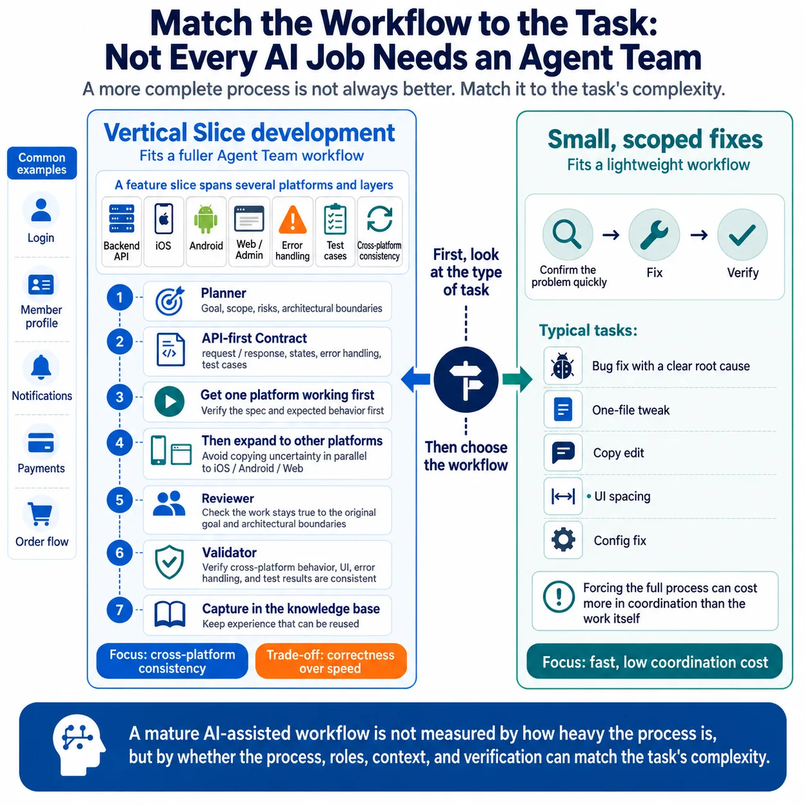

# Match the Workflow to the Task: Not Every AI Job Needs an Agent Team

Following up on my last post about why workflow matters, here is some practical experience from my own AI workflow.

A workflow is not better just because it is more complete.

It has to match the shape of the task.

Some tasks fit a lightweight process. Others need a fuller division of roles.

In my experience with Claude Code, Vertical Slice work fits a fuller workflow like Agent Team.

By Vertical Slice, I do not mean one layer, or one folder in a single repo.

I mean one user-facing feature, followed all the way from the backend API to the frontend or app UI, state handling, error handling, and test cases, with all of it aligned.

Think login, member profile, notifications, payments, or an order flow.

Take login. It looks like one feature, but it can touch:

The backend API  
The iOS login screen  
The Android login screen  
The login flow on Web or Admin  
Error handling  
Token and session management  
Test cases  
UI and behavior consistency across platforms

If each platform goes its own way, gaps appear.

The API contract may be understood differently.  
Error handling may drift apart.  
UI behavior may be inconsistent.  
Test cases may not line up.

This is where a fuller workflow like Agent Team earns its place.

Its value is not "running a few more AIs in parallel."

It is getting different roles to collaborate inside the same Vertical Slice.

The Planner first clarifies the goal, scope, test cases, risks, and architectural boundaries.

Then we go API-first and align on the contract: request and response, states, error handling, and test cases.

API, iOS, Android, and Web then build against the same contract and the same expected behavior.

But even with a workflow like Agent Team, that does not mean every platform starts at the same time.

My usual approach is to align on the API contract first, then pick one platform and get it working end to end.

The first platform often reveals a missing spec, an unclear state, or incomplete error handling.

Getting one platform working before expanding to the next keeps the same uncertainty from being copied into iOS, Android, and Web/Admin all at once, where it becomes much harder to untangle.

This is a judgment call, and reasonable teams differ.

Some teams start on every platform in parallel to gain speed.

My own trade-off is correctness over speed.

For me, the risk in Vertical Slice work is usually not slowness. It is a spec gap, a state design flaw, or weak error handling getting replicated across platforms.

So I get one platform working first, confirm that the contract and expected behavior hold, and only then expand to the next.

The Reviewer checks that the implementation stays true to the original goal and the architectural boundaries.

The Validator checks that behavior, UI, error handling, and test results are consistent across platforms.

Finally, the lessons worth keeping go back into the knowledge base.

This workflow is heavier. In Vertical Slice work, it is worth it.

What it handles is not a single change. It is consistency across several platforms, several roles, and several verification points.

On the other hand, take a bug fix with a clear root cause, a one-file tweak, a copy change, a simple UI spacing fix, or a config correction.

These do not need such a complete workflow.

The point of that work is to confirm the problem quickly, fix it, and verify it.

Forcing the full process onto it can cost more in coordination than the work itself.

So these days I try not to start with:

Can I hand this to AI?

I start with:

What kind of workflow does this task need?

Is it a Vertical Slice, where a fuller process keeps platforms consistent?

Or is it a small fix that one agent, or even a direct change, handles more efficiently?

The maturity of an AI-assisted workflow is not measured by how complete the process is, or by how many agents are running.

It is measured by whether the process, the roles, the context, and the way you verify can match the complexity of the task itself.

In short:  
Good AI workflow is not one-size-fits-all.  
It is about matching the workflow to the shape of the work.

P.S. Pair-written with Codex. Continuing to use an AI workflow to write about AI workflows.

## Infographic

## Adapted From

- [Traditional Chinese original](zh-TW.md)
