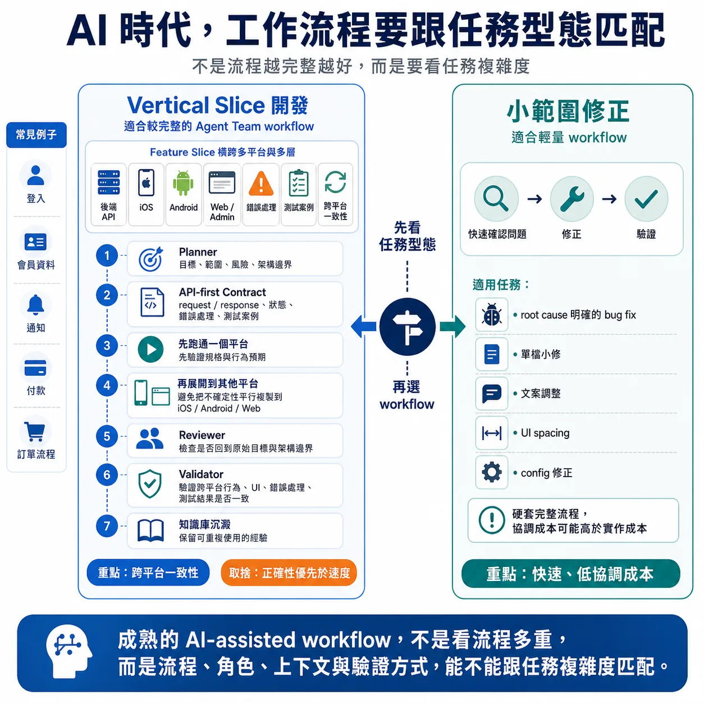

# AI 時代，工作流程要跟任務型態匹配

繼上一篇談到的工作流程重要性，這篇延伸分享個人實務的 AI workflow 經驗。

因為工作流程不是越完整越好，而是要跟任務型態匹配。

有些任務適合輕量流程，有些任務則需要比較完整的角色分工。

以我目前使用 Claude Code 的經驗來說，Vertical Slice 這類開發，會比較適合使用 Agent Team 這種較完整的工作流程。

所謂 Vertical Slice，不是只做某一層，也不是單一 repo 裡的一個資料夾，而是沿著一個使用者功能，從後端 API 到前端 / App UI、狀態處理、錯誤處理、測試案例都需要一起對齊的一個 feature slice。

例如登入、會員資料、通知、付款、訂單流程。

以登入為例，它看起來是一個功能，但實際上可能牽涉：

後端 API  
iOS 登入畫面  
Android 登入畫面  
Web 或 Admin 的登入流程  
錯誤處理  
token / session 管理  
測試案例  
跨平台 UI 和行為一致性

這類任務如果各平台各做各的，很容易出現落差。

API contract 可能理解不一致。  
錯誤處理可能各自發展。  
UI 行為可能不一致。  
測試案例可能沒有對齊。

這時候比較完整的工作流程，例如 Agent Team，價值就不是「多開幾個 AI 平行工作」。

而是讓不同角色在同一個 Vertical Slice 範圍內協作。

Planner 先把目標、範圍、測試案例、風險和架構邊界整理清楚。

接著用 API-first 的方式先對齊 contract：request / response、狀態、錯誤處理和測試案例。

API、iOS、Android、Web 再根據同一份 contract 和同一組行為預期實作。

但即使用了 Agent Team 這類流程，也不代表所有平台都要同時開工。

我的做法通常是：先對齊 API contract，再選一個平台先跑通。

第一個平台實作時，常常會發現規格遺漏、狀態沒想清楚或錯誤處理不完整。

先跑通一個平台，再展開到下一個平台，可以避免把同一個不確定性同時複製到 iOS、Android、Web/Admin，讓問題變得更難收斂。

這個做法當然見仁見智。

有些團隊會選擇一開始就多平台平行開工，追求速度。

但我自己的取捨是：正確性優先於速度。

對我來說，Vertical Slice 開發的風險通常不在於慢，而在於規格缺口、狀態設計或錯誤處理被平行複製到多個平台。

所以我會先讓一個平台跑通，確認 contract 和行為預期沒有問題，再展開到下一個平台。

Reviewer 檢查實作是否回到原始目標和架構邊界。

Validator 驗證跨平台的行為、UI、錯誤處理和測試結果是否一致。

最後再把值得保留的經驗沉澱回知識庫。

這樣的流程比較重，但在 Vertical Slice 開發裡是有價值的。

因為它處理的不是單一改動，而是多個平台、多個角色、多個驗證點之間的一致性。

相反地，如果是 root cause 已經很明確的 bug fix、單檔小修、文案調整、簡單 UI spacing 或 config 修正，就不一定需要這麼完整的流程。

這種任務的重點是快速確認問題、修正、驗證。

硬套完整流程，協調成本可能反而高於實作成本。

所以我現在比較不會先問：

這件事能不能交給 AI？

而是先問：

這件事需要哪一種工作流程？

是 Vertical Slice，需要比較完整的流程來維持跨平台一致性？

還是小範圍修正，用一個 agent 甚至直接處理會更有效率？

AI-assisted workflow 的成熟度，不是看流程多完整，也不是看 agent 開得多不多。

而是看流程、角色、上下文和驗證方式，能不能跟任務本身的複雜度匹配。

In short:  
Good AI workflow is not one-size-fits-all.  
It is about matching the workflow to the shape of the work.

P.S. Pair-writing with Codex. 繼續用 AI workflow 寫 AI workflow.
