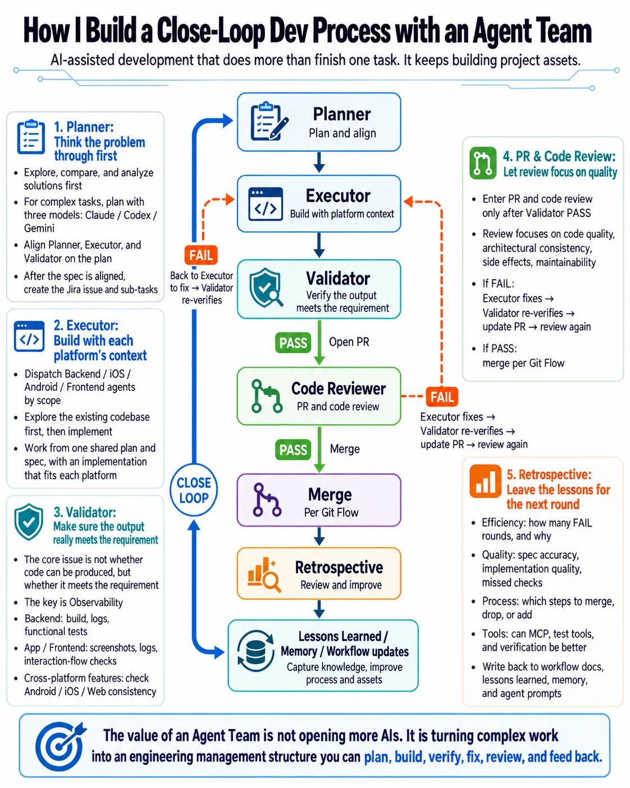

# How I Use an Agent Team to Build a Close-Loop Development Process

When people talk about an Agent Team, the first idea is often:

“Open a few more AIs and let them work in parallel.”

But in my experience, the value is not running more agents at once.

It is building a close loop:

Plan. Execute. Validate. Fix. Feed the lessons back into the next round.

My basic workflow looks like this:

```text
Planner
↓
Executor
↓
Validator
├─ FAIL → Executor fixes → Validator rechecks
└─ PASS → Create PR
    ↓
    Code Reviewer
    ├─ FAIL → Executor fixes → Validator rechecks → Update PR → Review again
    └─ PASS → Merge
        ↓
        Retrospective
        ↓
        Lessons Learned / Memory / Workflow updates
```

1. Planner: think before writing code.

For complex or high-risk tasks, I use Claude / Codex / Gemini to explore different approaches, then bring them into one plan.

Before work starts, Planner, Executor, and Validator align on that plan.

Executor can spot implementation gaps. Validator can spot gaps in how we will test the result.

Once the spec is aligned, I create the Jira issue and platform sub-tasks.

2. Executor: understand each codebase.

Platform agents explore the existing codebase before implementing the feature.

Backend, iOS, Android, and Frontend may have different architecture, state management, and error handling patterns.

They work from one shared plan and spec, while following each platform’s practices.

3. Validator: check the requirement, not just the code.

The problem is usually not whether AI can produce code.

It is whether the result meets the original requirement.

The key issue here is Observability: can Validator get enough evidence to judge the result?

Backend: builds, logs, and functional tests.  
App / Frontend: screenshots, logs, and interaction flows, including state and error handling.  
Cross-platform features: consistent behavior across Android / iOS / Web.

A FAIL goes back to Executor for fixes, then Validator checks again.

I only go back to the user for a design disagreement, a scope change, or a screen or log result that needs a human eye.

4. PR and Code Review: focus on quality.

Only after Validator PASS do I create a PR and move to review.

Code Reviewer checks code quality, architecture consistency, side effects, and maintainability.

If review fails, the changes go through implementation and validation again before the PR is updated and reviewed.

5. Retrospective: leave something useful for the next round.

I review efficiency, quality, process, and tools: why did checks fail, what did we miss, and what could work better?

The lessons go back into workflow docs, Lessons Learned, Memory, and agent prompts when needed.

The goal is for each module's close loop to run more smoothly than the last, with fewer FAIL rounds.

For me, an Agent Team is an engineering management structure.

Without a close loop, multiple agents only multiply uncertainty in parallel.

With a clear close loop, an Agent Team turns AI-assisted development from one-off output into an engineering process that keeps improving.

## Infographic



Originally posted on [LinkedIn](https://www.linkedin.com/feed/update/urn:li:activity:7515618682912444417/).
