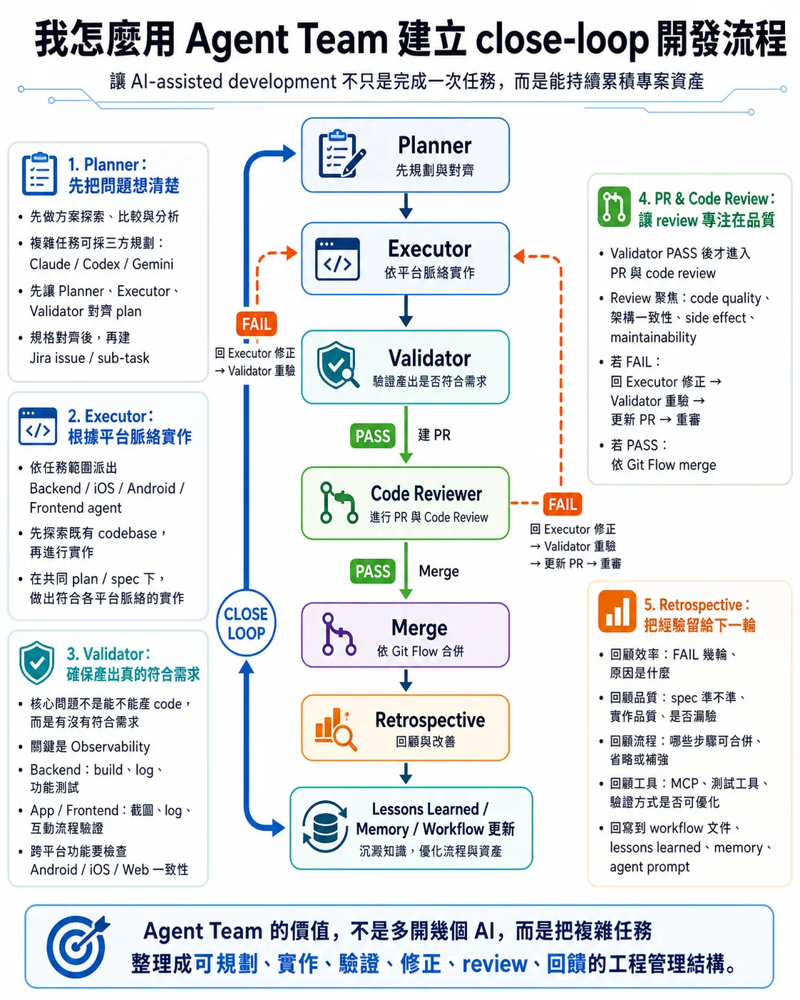

# 我怎麼用 Agent Team 建立 close-loop 開發流程



延續上一篇談到的：

複雜任務比較適合採用 Agent Team workflow。

這篇想分享我在實務上，怎麼把 Agent Team 跟 close loop 結合，讓 AI-assisted development 不只是完成一次任務，而是能持續累積專案資產。

很多人談 Agent Team，第一直覺會想到：

「多開幾個 AI 平行工作。」

但在我的經驗裡，Agent Team 的價值不在於同時跑更多 agent。

而是把開發流程整理成一個可以規劃、執行、驗證、修正、回饋的 close loop。

我的基本流程大概是：

```text
Planner
↓
Executor
↓
Validator
├─ FAIL → 回 Executor 修正 → Validator 重驗
└─ PASS → 建 PR
　　↓
　Code Reviewer
　　├─ FAIL → Executor 修正 → Validator 重驗 → 更新 PR → 重審
　　└─ PASS → Merge
　　　　　↓
　　　Retrospective
　　　　　↓
Lessons Learned / Memory / Workflow 更新
```

【1. Planner：先把問題想清楚】

Planner 的工作不是急著寫 code，而是先做解決方案探索、比較與分析。

如果是比較複雜或風險高的任務，我會採用三方規劃：

Claude / Codex / Gemini 從不同角度提出方案，再整理出最終 plan。

方案確認後，我不會直接丟給 Executor 開工。

我會先讓 Planner、Executor、Validator 對齊 plan。

因為 Executor 會從實作角度發現技術缺口。

Validator 會從驗證角度發現測試缺口。

這些回饋可以讓 plan 更完整，也能減少後面反覆修正的成本。

規格對齊後，再建立 Jira issue 和各平台 sub-task。

【2. Executor：根據平台脈絡實作】

Executor 會依照任務範圍派出不同平台的 agent，例如：

Backend、iOS、Android、Frontend。

Executor 的工作不是照抄 plan。

而是根據各平台的最佳實務，先探索既有 codebase，再進行實作。

同一個功能在不同平台上，可能有不同的架構慣例、狀態管理方式、錯誤處理方式。

所以 Agent Team 的目的不是讓每個 agent 各做各的。

而是讓它們在共同 plan 和共同 spec 下，做出符合各平台脈絡的實作。

【3. Validator：確保產出真的符合需求】

AI workflow 的問題，通常不是 code 產不出來。

而是產出物是否真的符合原始需求。

所以 Validator 最重要的工作，是確認實作結果有沒有達成原本的目標。

這裡最關鍵的議題是 Observability。

也就是 Validator 要如何取得足夠的資料，判斷產出到底正不正確。

不同平台會有不同驗證方式：

Backend：

build、log 驗證、功能測試。

App / Frontend：

截圖、log、互動流程驗證，包含畫面、狀態、錯誤處理，以及實際使用流程是否符合預期。

如果是跨平台功能，還需要檢查 Android / iOS / Web 之間的行為一致性。

如果 Validator FAIL，就回到 Executor 修正，再由 Validator 重新驗證。

這也是為什麼 Planning 階段要讓 Planner、Executor、Validator 先對齊。

Executor 可以提前理解實作邊界。

Validator 可以提前確認驗證方式。

等到真正進入開發時，整個 close loop 才比較容易收斂。

只有遇到設計分歧、scope 變動，或需要人眼確認的畫面 / log 結果時，才回到使用者確認。

【4. PR & Code Review：讓 review 專注在品質】

Validator PASS 後，才進入 PR 和 code review。

也就是先確認功能跑得起來、行為符合需求，再進一步檢查 code quality、架構一致性、side effect 和 maintainability。

Code Review 如果 FAIL：

回 Executor 修正 → Validator 重驗 → 更新 PR → 重新 review。

如果 PASS：

依照團隊 Git Flow 進行分支操作，例如 feature / dev / staging / main。

【5. Retrospective：把經驗留給下一輪】

這是我認為最重要的事。

每次任務結束後，我會回顧幾件事：

效率：

這次跑了幾輪 FAIL？每輪原因是什麼？

品質：

Planner spec 夠準嗎？Executor 實作品質如何？Validator 有沒有漏驗？

流程：

哪些步驟可以合併或省略？有沒有缺少的步驟？

工具：

MCP 工具、測試工具、驗證方式有沒有更好的做法？

這些回顧不只是聊天紀錄。

它會回寫到 workflow 文件、lessons learned、memory，必要時也會調整 agent prompt。

目標是讓每一個 module 的 close loop，都比前一個更順暢、更少 fail 輪次。

這也呼應我第一篇文章談的：

AI workflow 的價值，不只是當下完成了什麼，而是有沒有留下能被下一次工作使用的上下文。

所以對我來說，Agent Team 不是「多開幾個 AI」。

它比較像是一個工程管理結構。

讓複雜任務可以被規劃、實作、驗證、修正、review，最後再把經驗回饋到下一輪工作。

如果沒有 close loop，多 agent 只是把不確定性平行放大。

但如果 close loop 設計得夠清楚，Agent Team 就能把 AI-assisted development 從一次性產出，變成可以持續改善的工程流程。
