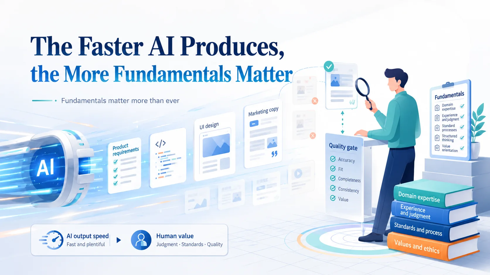

# The Faster AI Produces, the More Fundamentals Matter

When AI makes output much faster, what is left for humans to do?

Most discussions start with what AI can produce:

Requirements. Code. Designs. Copy.

Those are useful. But they lead to a more important question:

How do we know whether any of it is good?

AI can draft a PRD, but a PM still has to judge whether it addresses the real need and keeps the scope reasonable.

AI can write code, but an engineer still has to judge whether the solution belongs in the right layer and will be maintainable.

AI can generate screens, but a designer still has to judge whether the information hierarchy and flow actually work.

AI can write copy, but a marketer still has to judge whether it reaches the audience and fits the brand.

AI is fast at producing output.

It is just as fast at producing bad output.

Before AI, a lack of expertise might mean working slowly or needing more help. Now it can mean producing much more work without being able to tell whether that work is right.

If all we do is type a request and paste the result, we become the typist in the AI workflow.

I recently watched Matt Pocock’s talk, “Software Fundamentals Matter More Than Ever.”

That idea fits what I see in AI workflows.

Fundamentals matter more because they shape the quality of our questions. And the quality of our questions shapes the quality of AI output.

Without engineering knowledge, it is hard to spot code that will create maintenance problems later. Without design knowledge, “looks fine” may be all we can say, even when the hierarchy or flow needs work.

This is also why people keep talking about taste.

Taste is not mysticism.

It is judgment built from fundamentals, experience, observation, and repeated correction. It lets us see what is good, and what merely looks complete while missing the point.

In an AI workflow, humans still need to:

Define the problem.  
Set the standard.  
Judge trade-offs.  
Design verification.  
Own the final quality.

AI can be a strong executor. But we need to know where to go, what counts as a good result, and where we cannot compromise.

That is why prompt tricks matter less than the quality and depth of the conversation.

Can we ask good questions? Judge the answers? Refine the output into something that actually works?

AI makes the gap in expertise larger.

When output becomes cheap, the scarce skill is knowing what good looks like.

In short:

AI makes output faster.  
But fundamentals decide whether that output is actually good.

## Infographic

## References

- Matt Pocock, "Software Fundamentals Matter More Than Ever" — https://youtu.be/v4F1gFy-hqg

## Adapted From

- [Traditional Chinese original](zh-TW.md)
