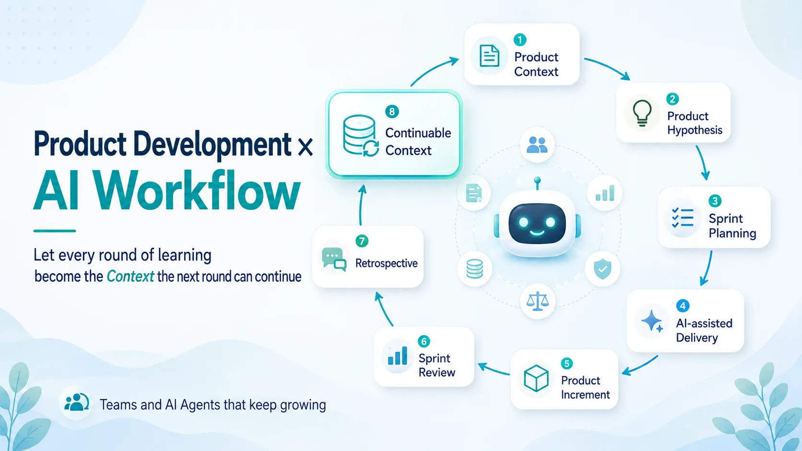

# How Product Development Meets an AI Workflow: Teams and Agents That Keep Growing

Picking up from my earlier posts on software development workflow, closed loops, and the speed of AI output:

If we widen AI collaboration by one more dimension, the bigger value is in the whole product development process.

In other words, the team and the AI Agent learn and grow together in every iteration.

More precisely: can what we learned in the last round really carry over into the next one?

This is very close to the heart of agile development.

When people talk about agile, they first think of sprints, standups, planning, review, and retrospectives.

But those are just the form.

What agile really has to deal with is this:

**Can we deliver a verifiable product increment in a shorter cycle, learn from the feedback, and do better in the next round?**

From a product development angle, an iteration should not start from a ticket. It should start from the product context.

What market are we facing?  
What is the customer's real problem right now?  
Which product hypothesis are we testing this round?  
Which constraints and trade-offs already exist?  
What result would show this direction is worth continuing?

Only then do we move on to breaking down requirements, sprint planning, engineering design, implementation, testing, demo, and release.

At the end, review and retrospective pull together the feedback from this round.

There are several kinds of feedback here.

The first is product feedback.

Did this feature solve the user's problem?  
Did the original product hypothesis hold?  
How did customers react to the demo?  
Does the data show this direction works?  
Next round: go deeper, adjust, or drop it?

The second is engineering feedback.

Was the requirement breakdown clear enough this time?  
Did the technical approach carry unnecessary complexity?  
Did the test strategy cover the real risks?  
Were the architectural boundaries broken?  
Which decisions should be recorded earlier next time?

The third is process feedback.

Did planning jump into implementation details too early?  
Did review find a gap in requirement understanding too late?  
Was the observability of QA and verification data enough to support a judgment?  
Where did team collaboration break down?  
How should the process change next round?

In the era of AI collaboration, there is one more kind: AI collaboration feedback.

Where did AI really help?  
Where did it make wrong calls because context was missing?  
Which kind of spec helps the agent most?  
Which verification steps cannot be left to AI to judge?  
Which lessons learned should be written back to the knowledge base, architecture decision records, or workflow docs?

This is also where I think retrospectives are underrated.

What a retrospective produces is, at its core, context.

It is not just meeting notes.

And it is not just a keep / problem / try list.

A retrospective that is really worth it turns this round's product learning, engineering learning, and process learning into context that the next round will read, use, and act on.

If nobody looks at it in the next planning after the retro is done.

If the lessons learned never make it into the PRD, Jira, architecture decision records, the knowledge base, or the workflow.

If the same vague requirements, test gaps, architecture misjudgments, and AI misuse show up again next sprint.

Then it is just an empty ritual.

This is why I think:

**The core of agile product development is not the sprint itself. It is using the retrospective to turn each round's learning into context the next round can use.**

Because AI is good at executing, and just as good at executing in the wrong direction.

If it does not know what the team has learned in the past.

If it does not know why we dropped an approach last sprint.

If it does not know that a piece of customer feedback actually changed the product priorities.

If it does not know that an API contract was designed this way for cross-platform consistency.

If it does not know that a test checklist item was added because of an earlier regression.

Unless all of that is organized into context it can read.

So the point of AI-assisted Agile is not to have AI open tickets, write user stories, or produce sprint reports faster.

You can do all of that, but it is not the core.

What matters more:

**Does the learning from each round of product development get turned into context that both the team and the AI Agent can carry into the next round?**

If yes, AI is more than a coding assistant.

It can help read past product hypotheses, organize customer feedback, check whether a requirement fits earlier decisions, warn about pitfalls we have hit before, help break down the next round's scope, and even point out verification gaps before implementation starts.

But if not, AI only works from a vague prompt in the moment, and quickly produces a pile of content that looks complete but may actually mislead direction and decisions.

It may make delivery faster.

But it does not necessarily make product learning faster. It may only help the team repeat the same mistakes faster.

So I now think of the product development loop in the AI era like this:

Product Context  
↓  
Product Hypothesis  
↓  
Sprint Planning  
↓  
AI-assisted Delivery  
↓  
Product Increment  
↓  
Sprint Review  
↓  
Retrospective  
↓  
Continuable Context  
↓  
Next Product Hypothesis

In this loop, AI does not only show up in the delivery step.

What AI can really amplify is the value that comes from context flowing through the whole loop.

It can help organize requirements.

It can help implement.

It can help verify.

And it can help turn the results of review and retrospective into product memory the next round can use.

So for me, AI actually makes the things in agile development that were always important, but often ignored, more obvious.

Short-cycle delivery is not the goal.

The real goal is short-cycle learning.

The retrospective is not the end.

It is where the next round's context begins.

AI collaboration is not limited to speeding up software implementation. It extends to product planning, engineering decisions, verifying results, and process adjustments, and all of that can become knowledge that keeps growing and accumulating.

That way, in the next round, not only do people know the product better. The AI Agent also understands better how this team works, how it judges quality, and how to avoid the pitfalls it has hit before.

So, agile in the AI era is not about running through a sprint faster.

It is about getting what each sprint learned back into the next round of product decisions faster, more clearly, and more reliably.

In short:

Agile is not just about faster delivery.

It is about faster learning.

And in the AI era, continuable context is what makes that learning compound.

## Infographic

## Adapted From

- [Traditional Chinese original](zh-TW.md)
