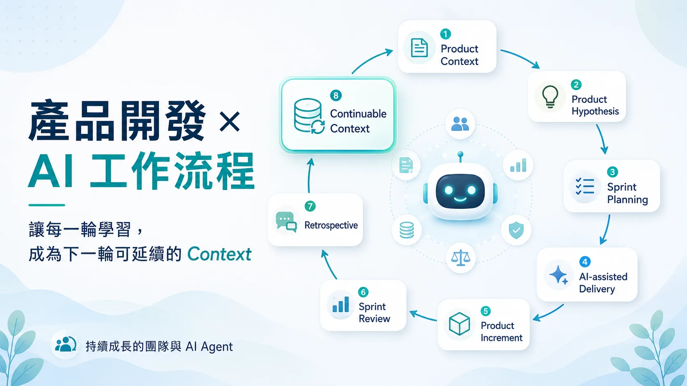

# 產品開發如何結合 AI 工作流程：持續成長的團隊與 Agent

延續前幾篇關於軟體開發流程、closed loop、AI 產出速度的討論：

如果再把 AI 協作流程橫向擴展一個維度，更大的價值是整體產品開發流程。

也就是說，讓團隊和 AI Agent 在每一輪 iteration 裡一起學習、一起成長。

更精確的說法就是「上一輪學到的東西，能不能真的延續到下一輪」。

這件事其實非常接近敏捷開發的本質。

很多人談敏捷開發，第一個想到的是 sprint、standup、planning、review、retrospective。

但這些都只是形式。

敏捷真正要處理的問題，是：

**我們能不能用更短的週期交付可驗證的產品增量，從回饋中學習，然後讓下一輪做得更好？**

如果從產品開發的角度看，一個 iteration 不該只是從 ticket 開始，而應該先回到產品脈絡。

我們面對什麼市場？  
客戶現在真正的問題是什麼？  
這一輪要驗證哪個產品假設？  
哪些限制和取捨已經存在？  
什麼結果代表這個方向值得繼續？

接著才會進入需求拆解、sprint planning、工程設計、實作、測試、demo、release。

最後透過 review 和 retrospective，把這一輪得到的回饋整理出來。

這裡的回饋其實有好幾種。

第一種是產品回饋。

這個功能有沒有解決使用者問題？  
原本的產品假設是否成立？  
客戶看到 demo 之後反應如何？  
數據有沒有顯示這個方向有效？  
下一輪應該加深、調整，還是放棄？

第二種是工程回饋。

這次的需求拆解是否足夠清楚？  
技術方案有沒有不必要的複雜度？  
測試策略有沒有覆蓋真正的風險？  
架構邊界有沒有被破壞？  
哪些決策下次應該提前記錄？

第三種是流程回饋。

planning 有沒有太早進入實作細節？  
review 有沒有太晚發現需求理解落差？  
QA 和驗證資料的觀測性是否足夠支撐判斷？  
團隊協作在哪個環節斷掉？  
下一輪流程要怎麼調整？

到了 AI 協作時代，還會多一種 AI 協作回饋。

AI 在哪裡真的幫上忙？  
哪裡因為缺少 context 而產生錯誤判斷？  
哪種 spec 對 agent 最有幫助？  
哪些驗證步驟不能交給 AI 自己判斷？  
哪些 lesson learned 應該回寫到知識庫、架構決策紀錄或工作流程文件？

這也是我覺得 retrospective 被低估的地方。

Retrospective 的產出，本質上就是 context。

它不只是一次會議紀錄。

也不只是 keep / problem / try 的清單。

真正有價值的 retrospective，是把這一輪的產品學習、工程學習、流程學習，轉成下一輪會被讀取、會被使用、會改變行動的 context。

如果 retro 開完之後，下一輪 planning 沒有人看。

如果 lesson learned 沒有進到 PRD、Jira、架構決策紀錄、知識庫或工作流程。

如果同樣的需求模糊、測試缺口、架構誤判、AI 誤用，下個 sprint 又重來一次。

那它就只是個沒有意義的形式。

這也是為什麼我會覺得：

**agile product development 的核心不是 sprint 本身，而是透過 retrospective 把每一輪學習轉成下一輪可用的 context。**

因為 AI 很會執行，也很會執行錯方向。

如果它不知道團隊過去學到了什麼。

如果它不知道上個 sprint 為什麼放棄某個方案。

如果它不知道某個客戶回饋其實改變了產品優先順序。

如果它不知道某個 API contract 是為了跨平台一致性才這樣設計。

如果它不知道某個測試 checklist 是因為前一次 regression 才補上的。

除非這些東西被整理成它可以讀取的 context。

所以 AI-assisted Agile 的重點，不是讓 AI 幫我們更快開 ticket、寫 user story、產 sprint report。

那些都可以做，但不是核心。

更重要的是：

**每一輪產品開發產生的學習，有沒有被轉成下一輪團隊和 AI Agent 都能延續使用的 context。**

如果有，AI 就不只是 coding assistant。

它可以幫忙讀過去的產品假設、整理客戶回饋、檢查需求是否符合既有決策、提醒過去踩過的坑、協助拆解下一輪 scope，甚至在實作前先指出驗證缺口。

但如果沒有，AI 只會根據當下模糊的 prompt，快速產出一堆看起來完整、實際上卻可能誤導方向與決策的內容。

它可能讓 delivery 變快。

但不一定讓產品學習變快，甚至可能只是讓團隊更快重複同樣的錯誤。

所以我現在會把 AI 時代的產品開發 loop 想成這樣：

Product Context  
↓  
Product Hypothesis  
↓  
Sprint Planning  
↓  
AI-assisted Delivery  
↓  
Product Increment  
↓  
Sprint Review  
↓  
Retrospective  
↓  
Continuable Context  
↓  
Next Product Hypothesis

這個 loop 裡面，AI 不只是出現在 delivery 那一段。

AI 真正能放大的，是整條 loop 裡 context 流動所帶來的價值。

它可以協助整理需求。

也可以協助實作。

可以協助驗證。

也可以協助把 review 和 retrospective 的結果整理成下一輪可用的產品記憶。

因此對我來說，AI 反而讓敏捷開發流程裡那些原本重要、但常被忽略的事情變得更明顯。

短週期交付不是目的。

真正的目的是短週期學習。

Retrospective 不是結尾。

它是下一輪 context 的開始。

AI 協作不僅限於加速軟體實作，還能擴展到產品規劃、工程決策、成果驗證、流程調整，這些都能變成持續成長與累積的知識。

這樣下一輪不只是人更熟悉產品，AI Agent 也更理解這個團隊怎麼工作、怎麼判斷品質、怎麼避開過去踩過的坑。

所以，AI 時代的敏捷流程：不是更快跑完 sprint。

而是讓每個 sprint 學到的東西，更快、更清楚、更可靠地回到下一輪產品決策。

In short:

Agile is not just about faster delivery.

It is about faster learning.

And in the AI era, continuable context is what makes that learning compound.

## 資訊圖

