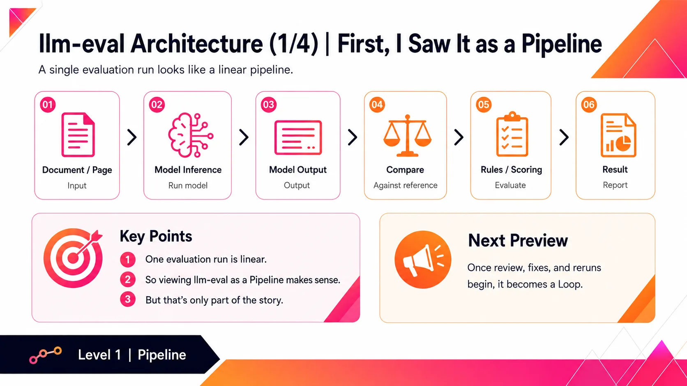
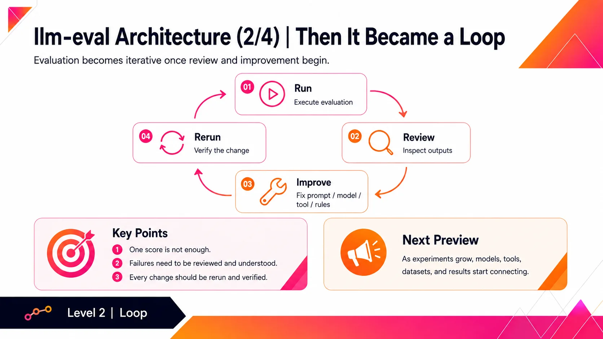
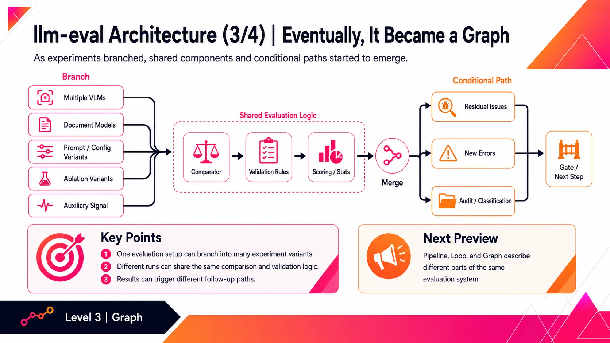
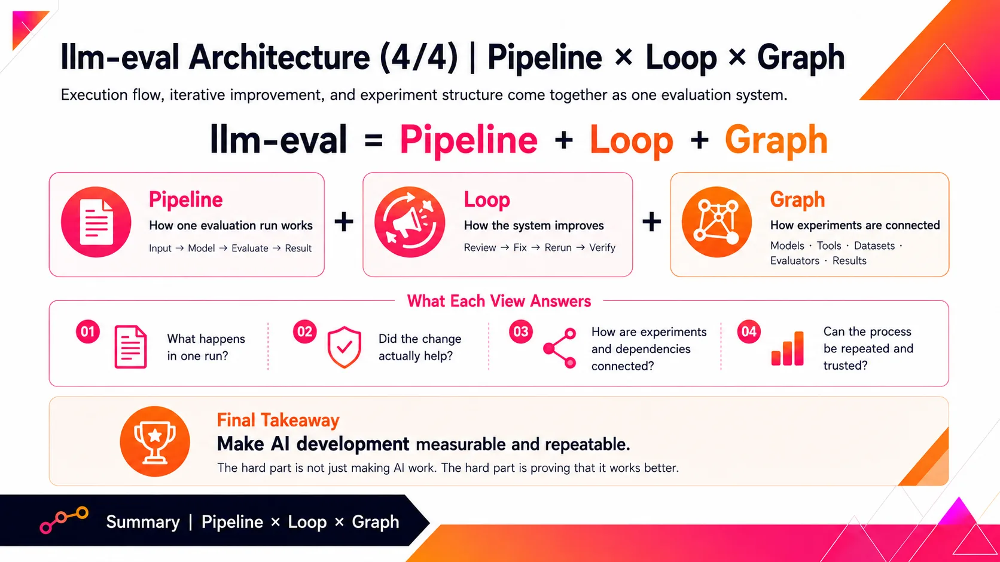

# From Pipeline to Loop to Graph: How My LLM Evaluation System Evolved

After building AI agents for a while, I’ve come to one conclusion:

Implementation is often not the hardest part.

Evaluation is.

Changing a prompt is easy.  
Switching a model is easy.  
Adding a tool is easy.

But then comes the real question:

How do you know it actually got better?

Did the new prompt improve accuracy?  
Did the new model solve more cases, or simply fail differently?  
Did adding a tool actually help?  
Did one improvement introduce regressions somewhere else?

Relying on a few manual tests or “it feels better” quickly stops working once the system becomes more complex.

That was why I started building my own llm-eval framework.

At first, it was just a simple pipeline:

Input → Model → Compare → Rules / Scoring → Result

The goal was straightforward: keep everything else fixed, change one variable, and compare the results.

Then I started working on a much harder problem:

How can an LLM reliably understand Taiwanese government documents written in Traditional Chinese?

That changed everything.

Evaluation was no longer just about calculating an accuracy score.

I needed to inspect failures, classify error patterns, review questionable cases, improve the workflow, rerun experiments, and verify whether each change actually helped.

The pipeline became a loop.

And as more models, tools, datasets, evaluators, judges, and experiment dependencies were added, I realized the system was no longer just a linear workflow.

It had become a graph.

Pipeline defines how one evaluation run works.

Loop defines how the system improves through repeated testing and correction.

Graph defines how experiments, models, tools, datasets, evaluators, dependencies, and results are connected.

What started as a small question—

“Did this change make the model better?”

—gradually evolved into a much larger engineering system for making AI development measurable and repeatable.

That is probably my biggest takeaway from building AI agents so far:

The hard part is not just making AI work.

The hard part is proving that it works better.

#LLM #LLMEvaluation #AIAgents #AIEngineering #MachineLearning

## Slides

Originally posted on [LinkedIn](https://www.linkedin.com/feed/update/urn:li:activity:7491409220853170176/).
