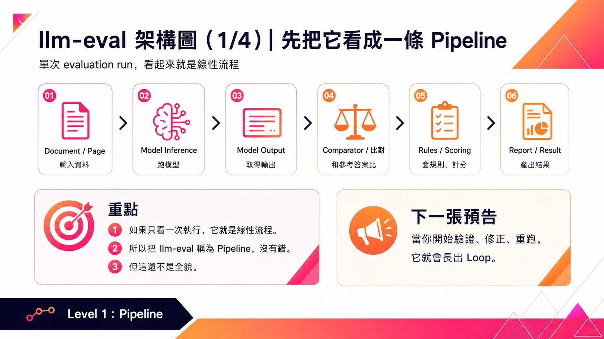
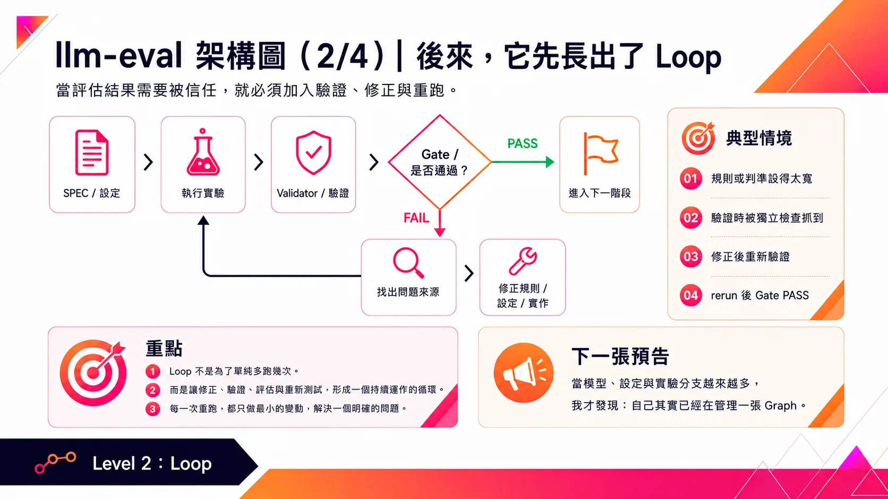
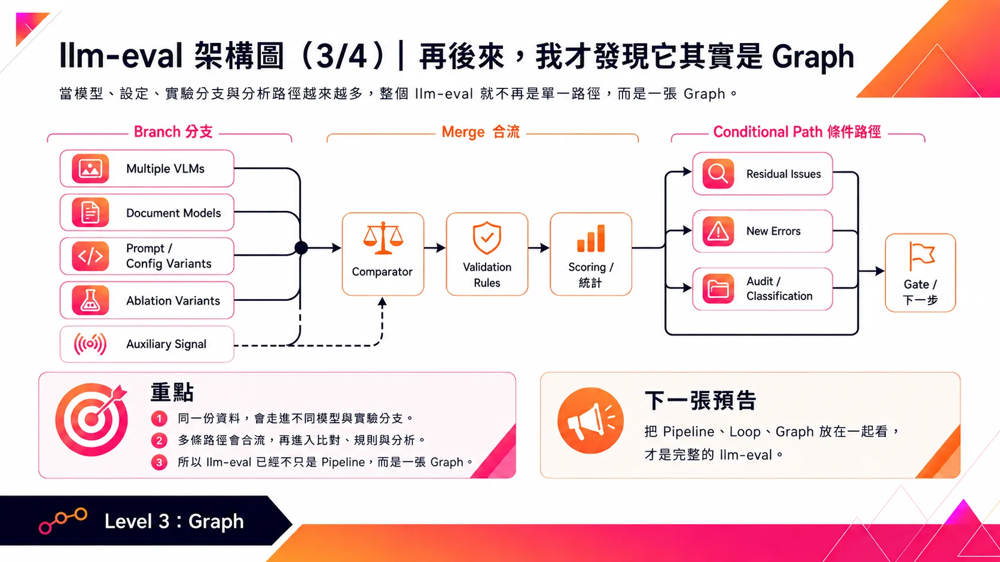
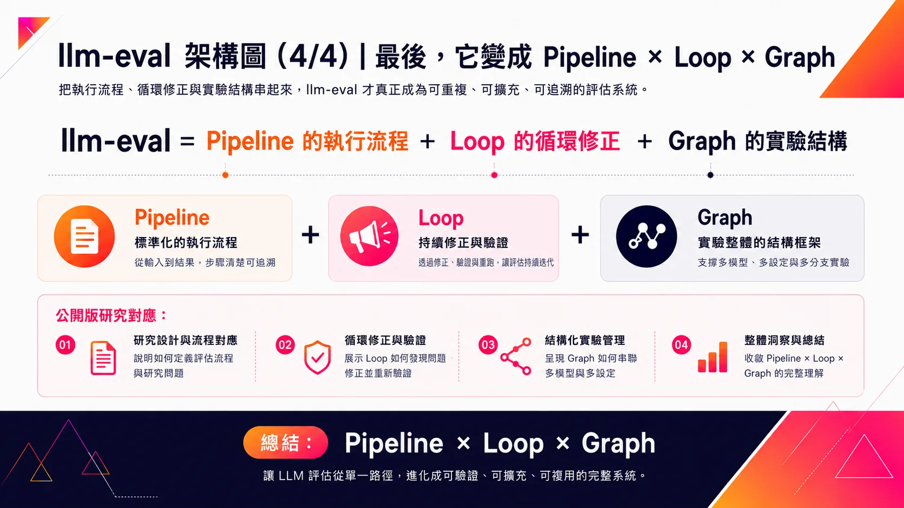

# 從 Pipeline 到 Loop，再到 Graph：我的 llm-eval 是怎麼一路長出來的

最近我在研究一件有趣的事：如何更客觀地評估與驗證 LLM 的能力。

起點很單純。

平常開發 AI 系統時，我可能只是改一版 Prompt、換 MCP Tool、調整設定，甚至直接換 Model。

但問題是：

我怎麼知道它真的變好了？

總不能每改一次，就自己問幾題、看幾個回答，再憑感覺說「這版好像比較準」。

早期 PoC 這樣做沒問題，但系統開始變複雜後，光靠人工測試或體感，很快就不夠用了。

而且現在網路上有太多 AI 的「建議用法」：Prompt 怎麼寫、要不要加 Reasoning、Agent Workflow 怎麼設計、Tool 怎麼接、哪個模型適合哪種任務……

別人說有效是一回事，但在我的工作環境上到底有沒有效，又是另外一回事。

所以我需要一個方法，像做實驗一樣，一次只改變一個條件、其他條件盡量固定，然後去比較結果。

把「我覺得比較好」，變成「我有數據證明它比較好」。

這就是我開始做 llm-eval 的原因。

——

一開始，它真的只是一條 Pipeline。

Input → Model → Compare → Rules / Scoring → Result

準備測試資料、跑模型、取得輸出、跟 Reference 比較，再經過 Scoring Rules，最後得到結果。

要回答的事情很簡單：

• 換 Model 有沒有比較好？  
• 改 Prompt 有沒有改善？  
• Tool 加進去後，正確率有沒有提升？  
• 不同設定之間，到底差多少？

從單次 Evaluation Run 來看，這就是一條標準的 Pipeline。

——

後來，我開始研究「怎麼讓 LLM 讀懂台灣政府文件」。

這也是 llm-eval 真正開始快速演化的地方。

Evaluation 根本不是最後看一個準確率，就可以收工了。

表格結構有沒有正確？  
Checkbox 有沒有看對？  
閱讀順序有沒有跑掉？  
文字是真的漏掉，還是 Validator 判斷錯誤？  
某個方法修好舊問題，會不會又產生新錯誤 ?

問題開始從：

「哪個模型分數比較高？」

變成：

「這個分數本身，可信度有多高？」

——

所以 Pipeline 開始長出了 Loop。

流程慢慢變成：

Execute → Validate → Gate → Fix → Rerun

跑完實驗後，要有 Validator。

Validator 發現問題，就要繼續判斷：是 Scoring Rule、設定、Implementation 有問題，還是模型真的做錯？

找到原因後修正，再跑一次、再驗證一次。

如果 Gate 沒過，就不能當作完成。

這時我才發現，原本的 Pipeline 已經長出 Loop 了。

因此我對 Loop Engineering 的認知是：

Loop 不是為了單純多跑幾次，而是讓修正、驗證、評估與重新測試，形成一個持續運作的循環。

而每一次 Rerun，都應該只做最小的變動，解決一個明確的問題。

——

再後來，我才發現它原來是 Graph。

實驗越做越多後，我不再只是測一個 Model、一個 Prompt、一個 Config。

而是開始有 Multiple VLMs、Document Models、Prompt / Config Variants、Ablation Variants、不同 Validation Rules 與 Analysis Paths。

有些實驗會 Branch，有些結果要 Merge，有些會進 Residual Issues、New Errors、Audit / Classification，最後再經過 Gate 決定下一步。

它早就不是單純的 A → B → C → D。

而是開始出現：

Branch、Merge、Dependency、Conditional Path。

到這時我才突然意識到：

我一直以為自己是在維護很多條 Pipeline，結果其實已經是在管理一張 Graph。

——

所以現在，我會這樣理解 llm-eval：

演化過程是：

Pipeline → Loop → Graph

而今天完整的架構則是：

llm-eval = Pipeline 的執行流程 + Loop 的循環修正 + Graph 的實驗結構

也就是：

Pipeline × Loop × Graph

——

所以，llm-eval 就是這樣長大的。

因為不想再靠體感評估，所以開始做 Pipeline。  
實驗流程需要不斷修正、驗證與評估，所以長出 Loop。  
實驗越來越多、相依性越來越複雜，所以最後變成 Graph。

回頭再看才發現：

很多架構不是先畫好再實作，而是在持續解決真實問題的過程裡，慢慢長出來的。

我想，llm-eval 還會繼續長下去。

#LLM #LLMEvaluation #AIEngineering #VLM #LoopEngineering #GraphEngineering #AIArchitecture #MLOps

## 輪播圖

