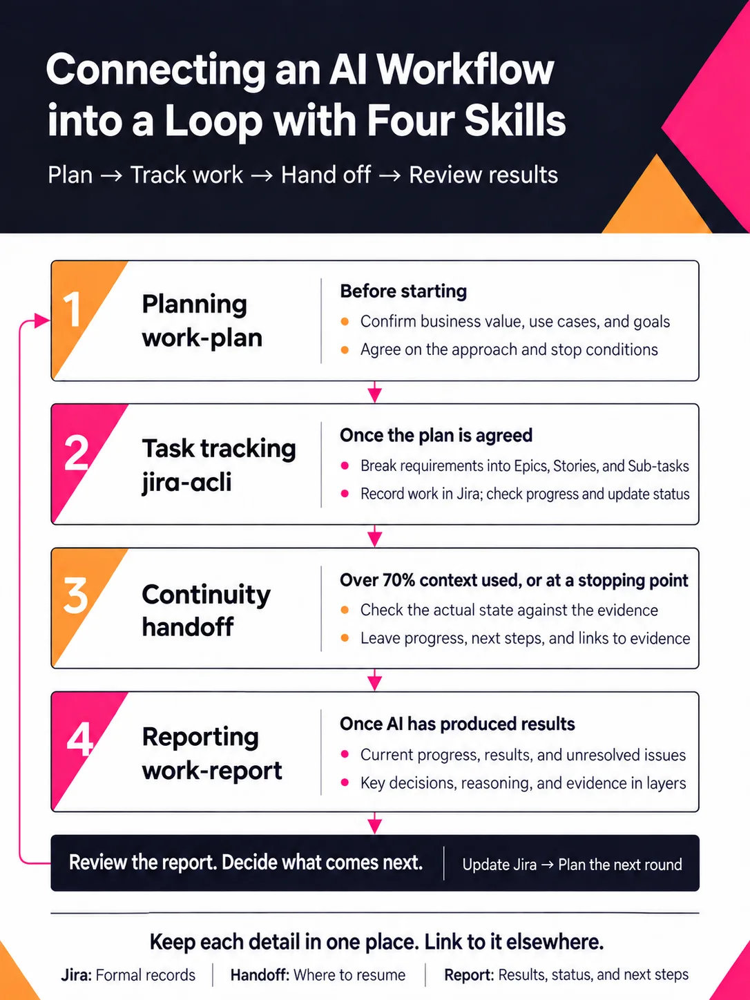

# Connecting an AI Workflow into a Loop with Four Skills

AI projects need a clear goal, tasks tied to that goal, and a way to check the results.

Longer projects also span conversations. Chat history alone makes progress hard to follow and discussed ideas easy to mistake for completed work.

Four skills help manage the work from planning through to the next round.

【work-plan: Plan before starting】

Have AI read the project state, architecture, and constraints. Discuss business value, use cases, and goals before deciding what to build.

Define expected behavior, acceptance criteria, the approach, and stop conditions before implementation.

Agree on the scope of autonomous work. Once approved, proceed within it. Return for discussion when direction or scope needs to change, or a stop condition is reached.

【jira-acli: Track the work】

Record business value in Epics, product goals and use cases in Stories, and the tasks needed to fulfill each Story in Sub-tasks.

Check completed tasks against the Story to see which requirements are met and what remains.

Use Atlassian's official CLI, acli, to create issues, check progress, and update status. CLI workers can read and write Jira directly.

For issue creation, MCP responses averaged 4,718 characters, compared with 78 for acli. Smaller responses leave more context for requirements, code, and verification.

【handoff: Continue across conversations】

Use handoff when context usage exceeds 70% or a stretch of work ends.

Verify the actual state, then update Jira. Carry forward the agreed direction, progress, next steps, unresolved points, and evidence links.

Distinguish code written, tests run, and acceptance criteria met.

If an approach was tried and abandoned, leave the reason too. That helps avoid spending the next conversation trying the same route again.

Link to details already in Jira.

【work-report: Review the results】

Start with current progress, results, and unresolved issues. Go deeper for key decisions, reasoning, and evidence.

Use diagrams, screenshots, and comparisons where they help. Keep completed results separate from future plans, and state what was checked and what remains unconfirmed.

Review the report, decide what comes next, and update Jira before planning the next round.

Keep each detail in one place, with links elsewhere: formal records in Jira, where to resume in the handoff, and results with supporting evidence in the report.

The next round starts with verified results and decisions from the previous one.

Skills on GitHub: [bits-and-bobs / ai / skills](https://github.com/shihhung/bits-and-bobs/tree/main/ai/skills).

## Infographic

