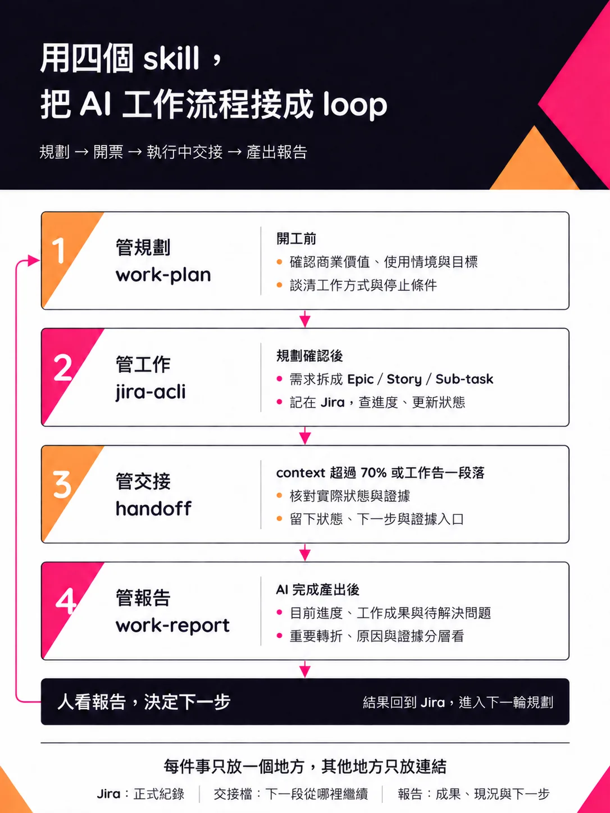

# 用四個 skill，把 AI 工作流程接成 loop

用 AI 做專案，開工前得先談清楚要解決什麼問題、做到什麼程度，再把需求拆成任務。

工作一拉長，就得分幾段對話做。換對話時要知道做到哪裡，有產出後也要看得懂結果，才知道下一步該繼續、調整，還是先停下來。

從開始到結束，會一直回頭確認：原本為什麼要做？現在完成了多少？結果有沒有滿足需求？

只靠聊天紀錄，每次都得重新翻找，也容易把討論過的方案當成已經做完的事。

沿著工作順序，分別用 work-plan、jira-acli、handoff 與 work-report 處理這幾件事。

【work-plan：開工前，先談清楚】

先讓 AI 讀專案現況，了解既有架構與限制，再一起討論這一輪的方向與目標。

從商業價值與使用情境談起，確認值得解決的問題，再決定要做什麼。規劃功能時，也把預期的使用方式與結果寫清楚，後面才有依據拆任務、驗收。

接著談架構定位、工作方式與停止條件。這次的改動放在哪裡、會影響哪些部分、怎麼確認做對了，都在開工前先整理好。

工作方式也包含先寫好驗收條件，再動手。做到最後，就能拿實際結果回頭核對，看看有沒有達到原本的目標。

自主執行的範圍也先講好。確認計畫後，就照計畫往下做；遇到方向要改、範圍要擴大，或碰到約定的停止條件，再回來討論。

【jira-acli：把計畫拆成可追蹤的工作】

計畫確認後，把需求與任務拆成 Epic／Story／Sub-task，記在 Jira。

在 Epic 記商業價值，在 Story 寫下符合 Epic 的產品目標與使用情境，再拆成滿足 Story 的 Sub-task。

這樣看一項任務時，可以一路查回為什麼要做、要解決哪個情境的問題。做完 Sub-task，也回頭核對 Story，確認滿足了哪些需求、還缺什麼。

透過 Atlassian 官方 CLI（acli）操作 Jira，開票、查進度、更新狀態都走這裡，也讓 CLI worker 自己讀寫 Jira。

實測建票回傳，MCP 平均為 4,718 字元，acli 為 78 字元。

查票、開票、更新狀態會反覆發生，每次少回傳一點內容，就能少占一些 context，留給需求、程式碼與驗證結果。

【handoff：換對話前，留下能接著做的資訊】

用掉超過 70% 的 context，或工作告一段落，就用 handoff 整理交接。

先核對實際狀態與證據，再更新 Jira 的正式紀錄。

交接時，把前面確認過的方向、目前做到哪裡、下一步與證據入口整理好。換一段對話，就能沿著已確認的計畫接著做。

寫了程式、跑過測試、通過驗收，分開記。還沒確認的事，也寫清楚，避免接手時誤判進度。

如果中途試過某個方向，最後決定放棄，也留下一點原因，省得下一段對話又從同一條路開始試。

已經記在 Jira 的內容，只留連結。交接時核對到哪裡，就寫到哪裡。

【work-report：有產出後，整理成看得懂的報告】

有產出後，用報告快速理解成果與現況，思考下一步。

開頭先放目前進度、工作成果與待解決問題。先看這一層，就能判斷還需要了解哪些細節。

想了解過程，再看重要轉折；需要核對判斷，就往下查原因與證據。

遇到複雜的流程或結果，也用圖、畫面與比較來說明。先看懂發生了什麼，再去讀細節，比從一長串執行紀錄裡找結論容易。

已經完成的結果、尚未執行的計畫，也分開寫。

即使跑通流程，還是要驗收內容。檢查過什麼、憑什麼判斷完成、還有哪些地方待確認，都寫清楚。

看完報告，決定下一步，再把結果記回 Jira，接著規劃下一輪。

每件事只記在一個地方，其他地方留連結。

正式紀錄放 Jira，從哪裡接著做寫在交接檔，成果與判斷依據整理成報告。

下一輪開工前，就能查到上一輪確認了什麼、為什麼這樣決定，再接著往下做。

這些 skill 放在 GitHub：[bits-and-bobs / ai / skills](https://github.com/shihhung/bits-and-bobs/tree/main/ai/skills)。

## 資訊圖

