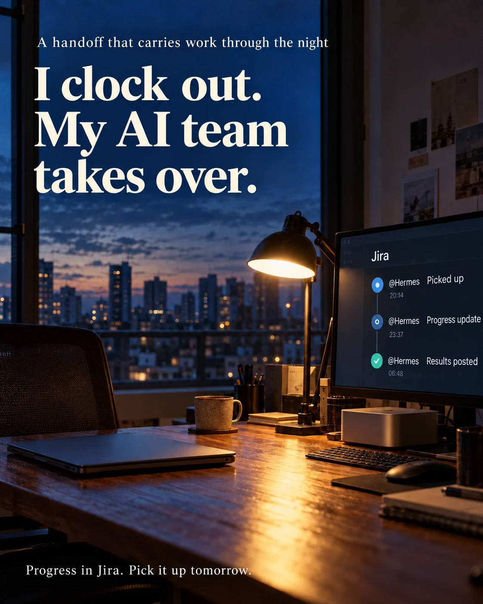

# I Gave Up on an AI Assistant Once. This Time, I Built an AI Team.

Before leaving work, I tag Hermes in a Jira issue.

It picks up the task on my M2 Pro, taking over from the work I've been doing on my M4 Max. It posts progress updates along the way and reports the results.

The next morning, I open the same issue, see where things stand, and take over again.

That's the use case that made an always-on AI assistant stick for me.

I'd tried OpenClaw before, but the setup was complicated, and I didn't have a clear job for it. Eventually, I stopped experimenting.

The recent wave of always-on assistants—Hermes, Muse, Grok Bot, and Dots—got me curious again. Data security was also on my mind as I explored how to fit one into my workflow.

This time, I started connecting Hermes to actual work.

**Jira** gave it visibility into tasks and a place to report back.

**GitHub** connected those tasks to the code.

**Claude Code** gave it a way to delegate development. I added my existing **Codex** account too, spreading usage across both tools.

**Google Workspace** helped move outputs between machines, including generated files and model weights from my own training runs.

**Obsidian** became the shared knowledge base. Lessons from Claude Code and Codex are recorded there automatically, and Hermes knows where to look when related work comes up.

Together, these connections formed a loop:

**Work during the day → hand off before leaving → Hermes works and reports back → review the next morning → continue.**

The outputs stay accessible. The lessons carry forward.

I'm still refining the setup. But this time, there's a concrete reason to keep using it: I can hand work over at the end of the day and return to a record of what happened, ready to pick it up again.

## Image

Originally posted on [LinkedIn](https://lnkd.in/p/gMdXpwU3).
