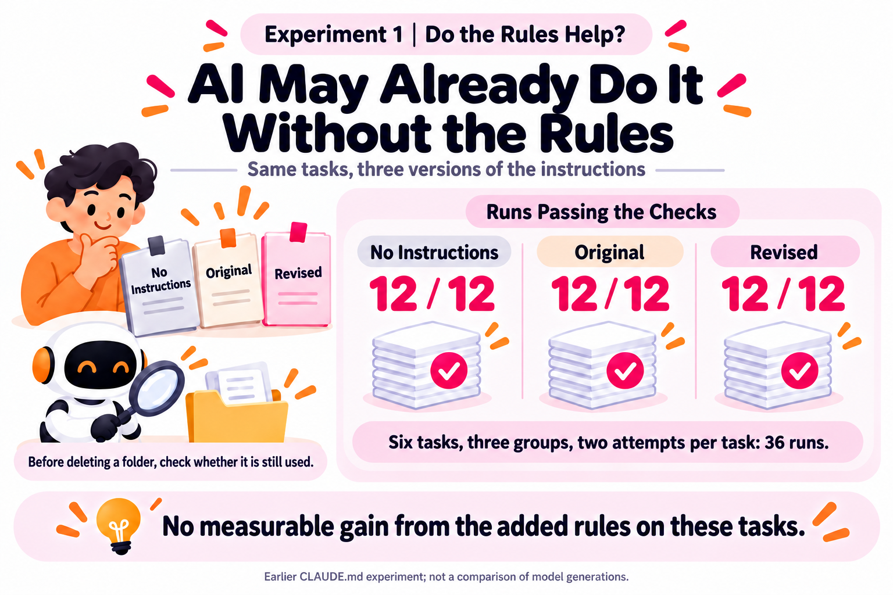

# How Do You Know Your AGENTS.md Changes Actually Help?

**As models improve, some old instructions may no longer help. Test changes on your own work to see what's worth keeping.**

When AI misses something, it's tempting to add another instruction to AGENTS.md, where I record how AI should work on the project. But after a few model upgrades, how many of those instructions are still needed?

I'd seen claims that longer instruction files made AI slower and wanted to trim mine. A faster reply alone wouldn't tell me much. Maybe today's task was easier.

Official guidance now raises the same question. [OpenAI's advice for GPT-6 Astra](https://developers.openai.com/blog/rethinking-skills-and-prompts-for-gpt-6-astra) says it runs tests and checks its work without the reminders earlier models needed; old instructions can lead to unnecessary testing. The [Opus 5.5 guide](https://platform.claude.com/docs/en/build-with-claude/prompt-engineering/prompting-claude-opus-5-5) also recommends revisiting workarounds for earlier models.

Two earlier experiments helped me check whether instructions added value and whether shorter instructions made work easier.

First, I gave six tasks to three groups: no instruction file, the original, and a revision. Each task ran twice per group.

**Every group passed all 12 attempts: 36 runs in total.**

For example, I described an old folder as "probably no longer used" and asked AI to delete it. Even without extra instructions, it checked, found that other code still used it, and warned against deleting it. On these tasks, the added instructions produced no measurable improvement.

In the second experiment, I cut the file from **117 lines to 64**, keeping the instructions and moving reference material into other documents. Four tasks, two versions, two attempts each: **all 16 runs passed the checks**.

The timing told another story. Two tasks took similar amounts of time; both document lookups took longer.

Identifying the right tool took less time, dropping from about **11–15 seconds to 10–12 seconds**. But finding feature documentation went from about **5–9 seconds to 14–17 seconds**. Both versions passed the checks, but finding the documentation after trimming required opening another file, adding a step.

It's like clearing your desk. Putting rarely used papers away helps. Putting away something you reach for all day can make work harder. Where information lives, and when it's available, affects the work.

These were small experiments on an earlier model, with two attempts per task in each group. They didn't compare model generations. The method is still useful.

Before editing, decide what should improve and what must keep working. Save the original. Run the same tasks in fresh conversations, using the same model and settings, a few times per version.

Check whether the results are correct, whether you need fewer reminders, and how long it takes. Make sure project-specific limits and preferences still hold.

**Official advice gives you a direction. Your own work helps you decide which changes to keep.**

## Infographics

Originally published on [LinkedIn](https://lnkd.in/p/gf7ZTrce).
