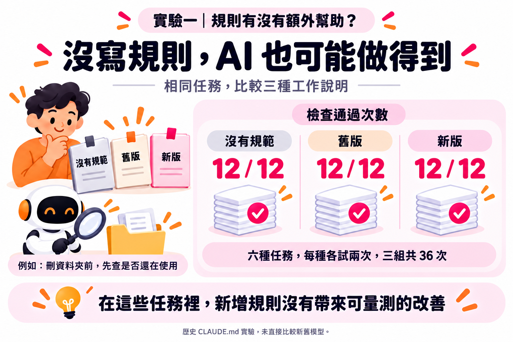
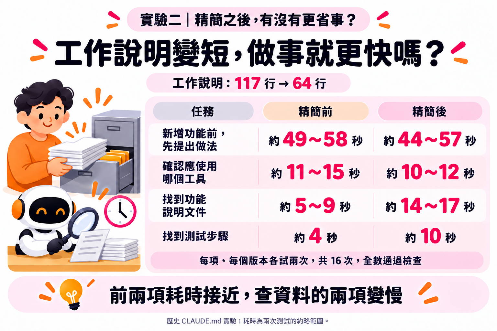

# 修改 AGENTS.md 後，怎麼知道 AI 有沒有更好用？

**模型進步後，有些舊規範可能已經多餘。哪些可以刪、刪了是否更好用，可以拿自己的工作來確認。**

用 AI 做事，遇到沒照期待做的地方，就會想在 AGENTS.md 補一條規範，讓 AI 知道之後該怎麼做。但模型換了幾代，當初加上的規範，還有多少需要留下來？

以前看到「規範寫越多，AI 反而越慢」的討論，也想試著精簡。可是今天回答比較快，可能只是今天問的事情比較簡單，怎麼知道修改真的有用？

現在官方也開始提醒重新檢查舊規範。OpenAI 針對 GPT-6 Astra 的指引提到，以前需要提醒跑測試、檢查工作的事，新模型已能自行做；舊規範反而可能造成多餘的測試。Anthropic 的 Opus 5.5 指南，也建議重新確認以前的補強是否仍然需要。[OpenAI 指引](https://developers.openai.com/blog/rethinking-skills-and-prompts-for-gpt-6-astra)、[Opus 5.5 指南](https://platform.claude.com/docs/en/build-with-claude/prompt-engineering/prompting-claude-opus-5-5)

之前用 AGENTS.md 做過兩組實驗，分別確認規範有沒有幫助，以及精簡後做事是否更省。

第一組，挑了六種任務，比較「沒有規範」「舊版」「新版」，每種任務各跑兩次。

結果，**三組各 12 次，全部通過，合計 36 次。**

例如，請 AI 刪除一個「應該沒人在用了」的舊資料夾。沒有額外規範的組別也先檢查了使用情況，發現還有程式用到它，便提醒不能直接刪除。在這些任務裡，即使沒寫規範，模型也做得到，新增規範沒有帶來可量測的改善。

第二組，把 AGENTS.md 從 **117 行縮到 64 行**，保留工作規範，將部分參考資料移到其他文件。這次選四個任務，兩個版本各跑兩次，**16 次也全部通過檢查**。

再把執行時間放在一起看，就出現差別：有兩項任務耗時接近，另外兩項查資料的任務則變慢。

例如，確認應使用哪個工具，從約 **11～15 秒變成 10～12 秒**，作業時間縮短；但找功能說明文件，卻從約 **5～9 秒變成 14～17 秒**。兩個版本都通過檢查，但找功能說明時，精簡後得另外開文件找，多了一道手續。

這就像整理桌面：不常用的資料收起來比較清爽，但是把常用的資料收起來卻可能更麻煩。

資料放在哪裡、什麼時候拿出來，都會影響工作效率。

當時這兩組都是小規模測試，每種任務、每組只測兩次，也沒有直接比較新舊模型。但是之前實驗留下來的方法，則可以繼續使用。

修改前，先想好希望改善什麼、哪些規範仍要保留。留下舊版，用同一個模型、相同設定，在新的對話裡做相同任務，各試幾次。

看看是否仍然做對、需要提醒的次數有沒有變少，以及花了多久時間。專案特有的限制與偏好，也要確認有沒有保留下來。

**官方建議提供方向，用自己的工作實驗，才知道哪些修改值得留下。**

## 資訊圖

原文發表於 [LinkedIn](https://lnkd.in/p/gaDYpKPf)。
